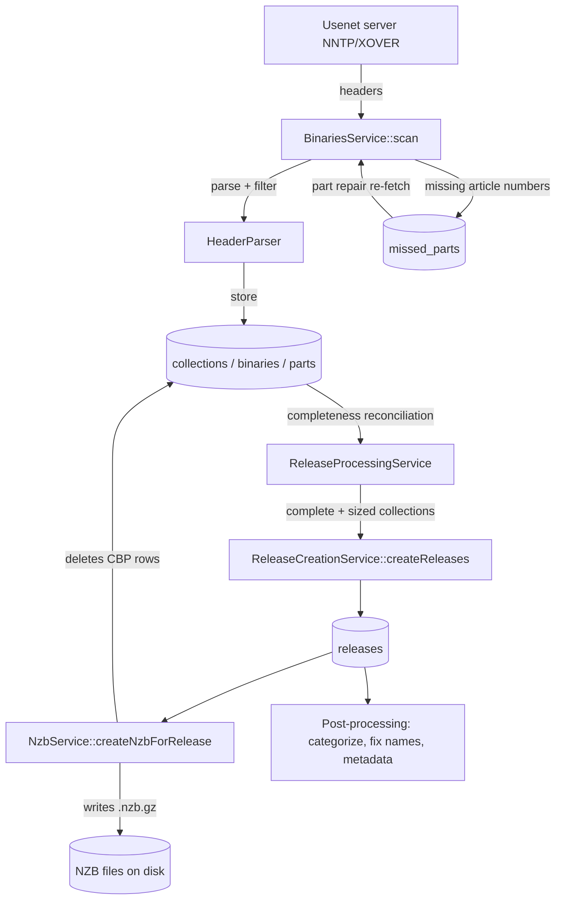
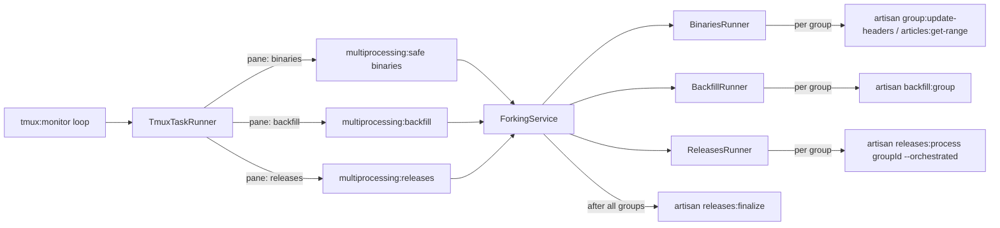

# The Indexing Pipeline: From Usenet Headers to NZB Files

This document traces the core flow of NNTmux: how the tmux-managed scripts
download Usenet article headers, how those headers are grouped into binaries
and collections, how complete collections become **releases**, and how a
`.nzb` file is finally written to disk.

It is intended as the first piece of the architecture documentation. Paths
below are relative to the repository root. Related documents:

- [NNTP providers](nntp-providers.md): the Usenet backbones, their roles and failover.
- [Provider gateway](provider-gateway.md): pacing, retries and circuit breakers for the
  external metadata services that post-processing asks.
- [Decision model](decision-model.md): the optional self-hosted model that arbitrates
  categories and checks music album matches.
- [Configuration](../configuration.md): the admin settings hub, section by section, and the
  site-level configuration files.

## Glossary

| Term | Meaning |
| --- | --- |
| **Article / header** | A single Usenet post. The indexer only downloads headers (subject, poster, message-id, byte count) via NNTP `XOVER`, never article bodies. |
| **Part** | One article that carries a piece of a file. Subjects look like `Some.Release "file.r01" yEnc (03/45)` — this article is part 3 of 45 of `file.r01`. Stored in the `parts` table. |
| **Binary** | One file, i.e. the set of parts that share a subject (minus the part counter). `file.r01` with its 45 parts is one row in `binaries`. |
| **Collection** | One multi-file post: all binaries that belong together (the rars, par2s, nfo of one upload). Grouped by a normalized subject. Stored in `collections`. |
| **Release** | A finished, searchable item created from a complete collection. Stored in `releases`. |
| **NZB** | Gzipped XML file listing every group/segment (message-id) needed to download the release. Written to disk; after that the collection/binary/part rows are deleted. |
| **Unknown payload candidate** | An NZB file entry whose subject is extensionless or ends in a non-informative extension (`.bin`, `.dat`, or `.file`). Additional processing may inspect one segment when no normal archive/media candidate exists; the term does not include known-but-unsupported formats such as ebooks. |

The database hierarchy during ingestion is:

```
collections (1) ──< binaries (N) ──< parts (N)
```

This "CBP" data is *staging data*. Once a release's NZB is written, the CBP
rows are deleted — the NZB file itself becomes the durable record of the
segments.

## High-level flow



## 1. Orchestration: the tmux layer

Everything is driven by long-running artisan commands inside a tmux session.

| Piece | File | Role |
| --- | --- | --- |
| `php artisan tmux:start` | `app/Console/Commands/TmuxStart.php` | Creates the tmux session, builds windows/panes via `TmuxLayoutBuilder`, then launches the monitor script in pane 0.0. |
| Monitor script | `app/Services/Tmux/Scripts/monitor.php` | Thin wrapper that execs `php artisan tmux:monitor`. |
| `php artisan tmux:monitor` | `app/Console/Commands/TmuxMonitor.php` | The heartbeat. An infinite loop (tick `TMUX_MONITOR_DELAY`, default 10 s; the counting queries refresh every `monitor_delay` seconds) that collects stats (`TmuxMonitorService`), redraws the monitor pane (`TmuxOutput`), and (re)spawns work in the other panes via `TmuxTaskRunner`. |
| `TmuxTaskRunner` | `app/Services/Tmux/TmuxTaskRunner.php` | Builds the shell command for each pane (with `nice`, logging via `tee`, and a `showsleep.php` delay) and respawns the pane with it. |
| `TmuxPaneManager` / `TmuxSessionManager` | `app/Services/Tmux/` | Low-level wrappers around the `tmux` CLI (`new-window`, `split-window`, `respawn-pane`, …). Panes are tagged with a role via the `@nntmux_role` pane option. |

### Window / pane layout (non-sequential mode)

Built by `TmuxLayoutBuilder` (`app/Services/Tmux/TmuxLayoutBuilder.php`):

- **Window 0**: Monitor, Binaries, Backfill, Releases
- **Window 1**: Fix names, Remove crap
- **Window 2**: Post-processing (additional, TV/anime, movies, metadata)
- **Window 3**: IRC scraper (predb)
- **Window 4**: Recovery (discovery / publication, downloads), see
  [Obfuscated recovery](#obfuscated-recovery)
- **Windows 5+**: optional monitoring tools (htop, mytop, redis, …)

Basic mode (`sequential = 1`) opens the same windows with only Monitor and
Releases in window 0.

### What each pane actually runs

Each monitor tick, `TmuxTaskRunner` respawns idle panes with one of these
commands (each pane's setting must be enabled, and "work available" counts
are checked first):

| Pane role | Command | Purpose |
| --- | --- | --- |
| Binaries | `php artisan multiprocessing:safe binaries` | Download new headers for all active groups. |
| Backfill | `php artisan multiprocessing:backfill` | Refresh `short_groups`, then give each eligible group one `backfill_qty`-capped child through the `backfillthreads` pool. |
| Releases | `php artisan multiprocessing:releases` | Turn complete collections into releases + NZBs. |
| Fix names | `php artisan releases:fix-names <level> --update --category=other --set-status --show` for levels 3, 5, 7, … 19 (plus 21 when `SRRDB_ENABLED`), then `multiprocessing:fixrelnames standard` and `multiprocessing:fixrelnames predbft`, each step bounded by `fix_names_timeout` | Rename badly-named releases using NFOs, file lists, par2, predb, archive CRCs, etc. |
| Remove crap | `php artisan releases:remove-crap …` | Delete spam/junk releases. |
| Post additional / TV / movies / metadata | `php artisan multiprocessing:postprocess add\|nfo\|tv\|ani\|mov\|ama` | Download samples/NFOs, match to TMDB/TVDB/IGDB/etc. The `ama` pass (books, console, games) ends with the music pass. |
| Post audio previews | `php artisan multiprocessing:postprocess aud` (metadata pane, after `ama`) | Fetch the head of a music release, clip a preview, render a spectrogram, persist tags. |
| IRC scraper | `php artisan irc:scrape` | Populate the `predb` table from scene pre channels. |
| Recovery discovery / publication | `php artisan obfuscation:discover --engine; php artisan obfuscation:publish --engine` | See [Obfuscated recovery](#obfuscated-recovery). |
| Recovery downloads | `php artisan obfuscation:download --engine` | See [Obfuscated recovery](#obfuscated-recovery). |

Every pane except the IRC scraper is supervised. Each step appends its exit
code, timing and failed pool children to `storage/tmux/panes/<role>.status`, and a
`cycle_end` line closes the cycle with its sleep. The monitor counts each finished
cycle once (`TmuxPaneSupervisor`, state in `storage/tmux/pane-supervision.json`,
cleared when the monitor starts), logs a warning per failed cycle and shows each
pane's last exit, duration and failures in a row. After
`TMUX_FAILURES_BEFORE_BACKOFF` failed cycles in a row it parks the pane, waiting
the pane's sleep (at least `TMUX_MONITOR_DELAY`) and doubling up to
`TMUX_MAX_BACKOFF_SECONDS`; one success resets it. A "no work" park waits for a
running batch to finish instead of killing it.

The `multiprocessing:*` commands all delegate to `ForkingService`
(`app/Services/ForkingService.php`), which dispatches to a runner in
`app/Services/Runners/`. Runners fan work out across worker processes
(one artisan child process per newsgroup / work unit, capped by the
`binarythreads` / `releasethreads` settings), using Laravel Processes or the
`Concurrency` facade.



`BinariesRunner::safeBinaries()` (`app/Services/Runners/BinariesRunner.php`)
is worth noting: it compares each group's local `last_record` against the
server's newest article number (from the `short_groups` stats table) and
splits large gaps into bounded `articles:get-range` chunks of `maxmssgs`
headers each, so many ranges of one group can be fetched in parallel. Small
gaps get a single `group:update-headers` worker.

## 2. Stage one: headers → collections / binaries / parts

Entry points `update:binaries`, `group:update-headers`, and
`articles:get-range` all end up in **`BinariesService`**
(`app/Services/Binaries/BinariesService.php`).

Per group, `updateGroup()`:

1. Selects the group on the NNTP server (`NNTPService`).
2. Runs **part repair** first (see below) if enabled.
3. Computes the wanted article range: from the group's stored `last_record`
   forward to the server's newest article (capped by `maxmssgs` per batch and
   `max_headers_iteration` per run). A new group starts `newgroupdaystoscan`
   days back when `newgroupscanmethod` is Days back, otherwise
   `newgroupmsgstoscan` articles back (Usenet Ingest → New groups).
4. Calls `scan()` for each batch.

`scan()` does the actual ingestion:

1. **Download** headers for the range via NNTP `XOVER` (optionally
   compressed).
2. **Parse & filter** each header with `HeaderParser`
   (`app/Services/Binaries/HeaderParser.php`):
   - The subject must match `^(.+?) \((\d+)/(\d+)\)` — i.e. *"name (part/total)"*.
     Anything else is counted as "not yEnc" and dropped. This regex is how a
     *binary part* is identified; `matches[1]` is the binary's name,
     `matches[2]/matches[3]` are the part number and total parts.
   - Headers matching the group's **black/white lists** (`BlacklistService`,
     `binaryblacklist` table) are dropped.
3. **Store** the surviving headers with `HeaderStorageService`
   (`app/Services/Binaries/HeaderStorageService.php`), in chunks, inside a
   transaction (`HeaderStorageTransaction`):
   - **Collection**: `CollectionHandler` asks `CollectionsCleaningService`
     to normalize the subject into a collection name — first trying the
     group-specific regexes in the `collection_regexes` table, then generic
     cleaning. The identity of a collection is
     `sha1(cleanedName . totalFilesInPost)` stored as `collections.collectionhash`
     — every part of every file of the same upload hashes to the same
     collection and is attached to it (`getOrCreateCollections`, bulk
     insert-or-lookup by hash). Cross-posted groups from the `Xref:` header
     are recorded in `collection_groups`.
   - **Binary**: `BinaryHandler` computes an identity hash within the
     collection: the md5 of the file number when the subject carries a file
     counter such as `[03/45]`, otherwise of the lower-cased subject and
     poster. All parts of one file map to one `binaries` row (name,
     `totalparts`, `filenumber`, `collections_id`).
   - **Part**: `PartHandler` buffers and bulk-inserts one `parts` row per
     header: `binaries_id`, article `number`, `messageid`, `partnumber`,
     `size`. The message-id is what later goes into the NZB `<segment>`.
4. **Track failures**: any article number that was requested but not received
   or not inserted is recorded in the `missed_parts` table
   (`MissedPartHandler`).
5. **Recovery capture**: on provider 1 only, while obfuscated recovery is
   enabled, each header chunk is also offered to recovery capture (see
   [Obfuscated recovery](#obfuscated-recovery)). A capture failure is logged
   and ordinary scanning continues.

### Part repair — finding the missing pieces

Usenet propagation is imperfect, so parts are often missing on the first
pass. Before fetching new headers, `BinariesService::partRepair()` re-requests
the article numbers listed in `missed_parts` (in ranges), and `scan(type:
'partrepair')` inserts whichever now arrive and removes them from the table.
Each miss increments an attempt counter; after `partrepairmaxtries` the row
is given up and purged. This loop is how "all of the parts of a binary are
found" over successive runs.

## 3. Stage two: collections → releases

`multiprocessing:releases` fans out one `releases:process <groupId> --orchestrated`
worker per group that has collections, `releasethreads` at a time
(`ReleasesRunner`), and then runs `releases:finalize` once
(`ForkingService`). `releases:process`
(`app/Console/Commands/ProcessReleasesCommand.php`) calls
**`ReleaseProcessingService::formReleases()`**
(`app/Services/ReleaseProcessingService.php`). The state machine lives in
`collections.filecheck` (`app/Enums/CollectionFileCheckStatus.php`):

| filecheck | Enum case | Meaning |
| --- | --- | --- |
| 0 | `Default` | Still accumulating parts. |
| 1 | `CompleteCollection` | All files present (intermediate). |
| 2 | `CompleteParts` | All files *and* all parts of each file present — ready to size. |
| 3 | `Sized` | `filesize` computed; ready to become a release. |
| 4 | `Inserted` | Release row created; awaiting NZB. |
| 5 | `Delete` | Marked for deletion. |
| 15 / 16 | `TempComplete` / `ZeroPart` | Edge cases for stale/zero-part handling. |

Per group, `formReleases()`:

1. Writes one page of NZBs for the group's releases still at `nzbstatus = 0`.
2. Walks the group's collections in discovered pages, for up to 60 seconds:
   `Sized` and `CompleteParts` first, then the waiting states through the
   due-collection lookups described below. Each page runs these steps in
   batches of eight collections:
   1. **Late-header merge** (`LateHeaderMerger`) — late headers for an
      incomplete release fill it instead of being discarded as a duplicate.
   2. **Reconcile counts** from the ground up: parts are the authority for
      each binary's `currentparts`/`partsize` (`partcheck = 1` when
      `currentparts >= totalparts`), and binaries are the authority for the
      collection's `filesize` and completeness. A collection is promoted to
      `filecheck = 2` when every expected file is present and complete.
      After every contributing ingestion frontier has moved `delaytime`
      hours of posting time beyond the last part, collections are
      *force-completed* with whatever files they hold (see Collection
      clocks). A late collection, whose `collectionhash` already has a
      release, is force-completed 15 minutes after its last stored header
      instead.
   3. **`processCollectionSizes()`** — promotes `2 → 3` (sizes were already
      aggregated in the previous step).
   4. **`deleteUnwantedCollections()`** — drops sized collections that fail
      group/site limits (min/max size, min files) or consist only of `.par2`
      files.
   5. **Create releases** — `ReleaseCreationService::createSelectedCollections()`
      (`app/Services/ReleaseCreationService.php`). For each `filecheck = 3`
      collection:
      - Clean the subject into a human search name
        (`ReleaseCleaningService::releaseCleaner`, `release_naming_regexes`).
      - Try to match a scene **predb** title (`Predb::matchPre`).
      - **Duplicate check** (`ReleaseDuplicateFinder`) — duplicate collections
        are deleted instead of inserted.
      - **Categorize** (`CategorizationService::determineCategory`) from the
        name/group/poster. When the [decision model](decision-model.md) is
        on, a weak result can be sent to it for arbitration.
      - **Measure `completion`** (`CollectionCompletionMeasurer`) — one SQL
        aggregate over the collection's binaries and parts. It happens here
        because stage three deletes those rows, and because a release whose
        NZB write keeps failing must still know how complete it is. `0` is
        kept as the "never measured" sentinel when the subjects declare no
        usable totals, or when the declared file count and the per-file
        totals contradict each other.
      - Insert the `releases` row (new GUID, `nzbstatus = 0`, the measured
        `completion`), link the collection (`filecheck = 4`, `releases_id`),
        and record cross-post groups in `releases_groups`.
   6. **`createNZBs()`** for the releases just created — see next section.
3. Runs [collection reconciliation](#collection-reconciliation) for the
   group (`PendingReconciler`).
4. Writes another page of pending NZBs, then deletes stuck collections
   (`collection_timeout`).

Ordinary formation and cleanup leave out collections that collection
reconciliation or obfuscated recovery owns.

`Sized` and `CompleteParts` collections are walked by ID every run. The
waiting states (0, 1, 10, 15 and 16) are found by index lookups instead
(`DueCollectionLookup`), so a run reads the collections that may have become
due rather than every waiting collection of the group:

- **frontier-due** — no head stamp, or a head at least `delaytime` behind
  the group frontier (on an inactive group: no `last_seen_at`, or none
  for `delaytime` hours);
- **touched** — a header stored since the previous pass started, less a
  five-minute overlap for transactions that committed after it started;
- **late** — the last header crossed the 15-minute late line since the
  previous pass.

Each lookup only chooses rows: the readiness predicate, ownership,
admission screening, late-header merge, recount and the steps above still
decide every row it returns. A lookup walks in (stamp, id) order from a
position kept in `collection_sweep_cursors`, so due rows that stay held
cannot starve the rows behind them. Every run serves all lookups before
any walk work. The full ID walk of each waiting state stays as a safety
net: it starts a new pass at most once an hour per group and state, and a
pass under way resumes in later runs until it is exhausted. A row every
lookup misses, such as one an ownership reset returned to `filecheck = 0`
without a new header, waits at most about an hour longer.

Without `--orchestrated`, `releases:process` then deletes finished and
orphaned CBP rows (`deleteCollections()`); run without a `groupId` it also
does the release-level cleanup that `releases:finalize` does.

`releases:finalize` (`app/Console/Commands/FinalizeReleasesCommand.php`) runs
once per cycle, after every group: it writes NZBs until a batch comes back
smaller than `maxnzbsprocessed`, deletes finished and orphaned CBP rows, and
then does the release-level cleanup: `deletedReleasesByGroup()`,
`deleteReleases()` (releases over retention, passworded, cross-posted,
incomplete, in disabled categories or genres, under a category's minimum
size, or carrying executables, and the Misc retention windows) and
`categorizeReleases()`.

### Collection reconciliation

One posting can end up as several collections, each holding fewer files
than the posting declares. Collection reconciliation (`app/Services/CollectionReconciliation/`)
proves from the posting's own PAR2 index which of those collections belong
together, and forms one release from them. It always runs when its tables
exist; there is no on/off setting.

- **Candidates**: quiet collections in states 0, 1, 2, 3, 10, 15 or 16 that
  declare more than one file but hold fewer binaries than declared
  (`PendingReconciler`). Neighbours must share group, poster and declared file
  count and lie within an hour of each other; at most 256 collections and
  1,024 files are considered, and exactly one base PAR2 file must be present.
  A cheap pre-screen (`CollectionAdmission`) never opens a provider
  connection.
- **Evidence**: through the NNTP pool it fetches the HEAD of each file's
  first article, every segment of the base PAR2 and of the other PAR2 files,
  and up to four first-article bodies of data files whose names compete
  (`PostingEvidence`). Responses are cached in `reconciliation_evidence`.
- **Publication**: a proven posting is inserted as one release, passes the
  same formation floors (minimum/maximum size, minimum files), gets
  `reconciled_postings` and `reconciled_sources` rows, and its NZB is written
  from the PAR2-proven inventory (`PostingPublication`). A later collection
  that matches an already published posting is added to it as late files,
  or deleted as a replayed duplicate (`LatePostingReconciler`).
- **Ownership**: collections that are admitted, claimed or mid-publication
  are hidden from ordinary formation and cleanup (`CollectionOwnership`), and
  new headers reset a claim.

Each `formReleases()` call reconciles at most `candidate_limit` candidates
and stops admitting work after `cycle_seconds`. Evidence downloads are
limited by the admin settings Release Formation → Reconciliation →
`reconciliation_hourly_mib` (default 256 MiB per UTC hour) and
`reconciliation_daily_mib` (default 2,048 MiB per UTC day), shared by all
workers. When either allowance is spent, downloads wait and a
`reconciliation_budget_deferrals` row is written; the attempt is not counted.
The tmux monitor shows "Reconciliation" usage and deferrals for this hour and
today. The other limits live in `config/collection-reconciliation.php`:

| Key | Default | Limits |
| --- | --- | --- |
| `candidate_limit` (`COLLECTION_RECONCILIATION_CANDIDATE_LIMIT`) | 100 | Candidates plus publication resumes per cycle. |
| `cycle_seconds` (`COLLECTION_RECONCILIATION_CYCLE_SECONDS`) | 30 | Seconds before no new work is admitted; work in flight finishes. |
| `head_bytes` / `body_bytes` | 64 KiB / 2 MiB | Largest single HEAD / BODY response. |
| `request_seconds` | 20 | Timeout for one article fetch. |
| `decision_bytes` | 16 MiB | Total download for one decision; when spent, the claim stops for good (`decision_budget_exhausted`). |
| `decision_seconds` | 900 | Deadline for one decision across its retries. |
| `lease_seconds` | 120 | How long a worker holds a claim. |
| `retry_seconds` | 60, 300 | Wait after the first and second failure; the third failure ends the claim (`retry_exhausted`). |
| `cache_seconds` | 7 days | Lifetime of a cached evidence row. |
| `hour_bytes` / `day_bytes` | 256 MiB / 2 GiB | Used only when the matching admin setting is missing or invalid. |

Expired evidence rows are purged hourly at minute 37 by the scheduled
`cleanup-reconciliation-evidence` task (`routes/console.php`).

Historical releases that were formed separately can be joined with
`php artisan releases:reconcile-fragments`. Without `--apply` it only plans
and prints the plan, writing nothing. Select the source releases with
`--release=ID` (repeatable) or with `--group`, `--from` and `--to` (a UTC
posting-date range of at most one hour), cap them with `--max-candidates`
(2 to 256, default 100), choose the release to keep with `--anchor`, and
write the plan to a new file with `--report`. `--apply --digest=<digest of
the reviewed plan>` applies it: the anchor's NZB is backed up beside itself
as `<path>.before-reconciliation.<digest of that NZB>` and then rewritten
(`app/Services/CollectionReconciliation/HistoricalReconciliation.php`).

## 4. Stage three: writing the NZB

`ReleaseProcessingService::createNZBs()` claims releases with
`nzbstatus = 0` (claim tokens + bounded retry attempts, see
`NzbCreationCandidateQuery`) and calls
**`NzbService::createNzbForRelease()`** (`app/Services/Nzb/NzbService.php`):

1. Load the release's collections; verify no collection is empty and no
   binary has zero parts (deterministic failures → the release is deleted
   after max attempts; transient failures are retried).
2. Stream-write gzipped XML with `XMLWriter` to a **temp file**:
   - `<head>` metadata (category, name);
   - one `<file poster date subject>` element per binary, with the
     collection's cross-post `<groups>`;
   - one `<segment bytes number>message-id</segment>` per part, paged out of
     the `parts` table in keyset-ordered chunks.
3. Atomically move the temp file into place at
   `{nzbpath}/{split-dirs}/{guid}.nzb.gz`, where the directory fan-out comes
   from the first hex chars of the release GUID (`nzbsplitlevel` setting).
4. Mark the release `nzbstatus = 1` (`NZB_ADDED`).
5. **Delete the collections/binaries/parts** for the release
   (`CollectionCleanupService`) — the staging data has served its purpose.

A release formed by collection reconciliation (it has a `reconciled_postings`
row) is handed to `PostingPublication::write()` instead, which writes the NZB
from the proven file inventory; see
[Collection reconciliation](#collection-reconciliation).

From this point the release is live: it is searchable (Manticore
indexes are populated from `releases`), appears in the web UI and API, and
the API serves the stored `.nzb.gz` when a user grabs it. Post-processing
panes continue to enrich it (proper names, movie/TV/game/music metadata,
NFOs, previews) asynchronously.

### Name-fixing donor trust

Cross-copy name fixing can propagate a name between similarly sized releases
that share a mediainfo UID, PAR2 16K hash, or inner-file CRC32. A donor is
eligible when it has a PreDB/AniDB identity or its current name is explicitly
marked trusted in `releases.is_trusted_name`. The flag is written for names
that were proper at release creation or came from strong content evidence
(PreDB, NFO, PAR2, RAR inner names, NZBSPLIT, mediainfo, SRR, or an earlier
donor match). Plausibility-gated and Descriptive Title renames deliberately do
not set it, so a readable-looking guess cannot spread to other copies. The
legacy `nonscene@Ef.net (EF)` UID exception remains eligible.

The migration deliberately leaves existing rows untrusted: historical
`proc_*` flags prove only that a source was processed, not that it supplied the
current name. PreDB/AniDB identities remain directly eligible, while future
strong renames record exact provenance in the trust flag.

PAR2 file-description hashes are always retained in `par_hashes` when read.
`ADD_PAR2` controls only whether those described files are also exposed in
`release_files`; disabling that display preference no longer disables PAR2
hash donors.

### SRRDB archive-CRC name fixing

SRRDB name fixing is an opt-in scene-release source. Levels 21 (recent) and
22 (all) take distinct Archive CRCs from `release_files`, prioritize primary
archives and large files, and query SRRDB's `archive-crc` search. A search hit
is not sufficient: the details response must repeat the queried CRC with the
exact inner-file size, only one candidate may survive, and a complete
release's total size must be within the configured donor-size tolerance.

Confirmed matches create or reuse a `predb` row with source `srrdb`, attach it
to the release, preserve SRRDB's IMDb id when present, and mark the name
trusted. Zero-result and confirmed-result lookups are cached persistently by
CRC with separate TTLs. Ambiguous lookups are marked separately from ordinary
processed misses. Transient failures remain pending.

`SRRDB_ENABLED=false` is the default. When enabled, the tmux fix-names pane
adds level 21. Request volume is bounded per cycle and to at most one request
per second by default; requests go through the
[provider gateway](provider-gateway.md), where 408/425/429/5xx responses use
exponential backoff and repeated failures open a circuit breaker that lasts
for the rest of the run. This integration only
performs exact lookups for local candidates; it does not crawl or scrape
SRRDB.

### PAR2 sidecar releases

Some posters upload the PAR2 repair files of a post as a separate posting,
which becomes its own release. When that PAR2 set describes the files of a
release whose own name says nothing, the PAR2 sidecar code
(`app/Services/Par2Sidecar/`) names the payload release from it and, when
it can, merges the two.

- **Evidence**: additional processing hashes the first 16 KiB of each
  unknown payload file's first article (`payload_prefix_hashes`), and PAR2
  processing records each file descriptor's 16 KiB hash and size
  (`par2_file_descriptors`, `par2_sidecar_inventories`). No extra download is
  made for the sidecar match.
- **Matching** runs in name fixing (`SidecarWork`, from the standard sweep
  and from `releases:fix-names` PAR2-hash runs), a bounded batch of at most
  100 targets per run. A target must not be renamed yet (`isrenamed = 0`); a
  descriptor must match on both 16 KiB hash and size; captures older than 72
  hours expire.
- **Effect**: the target is always renamed to the PAR2-described file name.
  It is also combined with the sidecar when both releases are 100% complete
  with complete stored NZBs, the PAR2 set is pure and complete, describes
  only this target and matches its payload, and the admin setting
  Post-Processing → PAR2 sidecars → `par2_sidecar_absorb` ("Combine matching
  repair releases", on by default) is on. Combining appends the sidecar's
  NZB `<file>` entries to the target's NZB, sums `size`, `totalpart` and
  `declaredfiles`, widens `firstarticle`/`lastarticle`, copies the PAR2
  hashes, and deletes the sidecar release (reason `par2_sidecar_combined`).
- **Journal**: each job is a `par2_sidecar_operations` row whose rows are
  kept, so a release is never processed twice; its stored NZB copies are
  cleared when the job finishes. Failed steps retry after a minute.

There is no command or environment key for it.

### Extensionless payload sniffing

Additional processing normally selects work from subject extensions. When a
release has no recognized archive, media, image, or audio candidate, the
planner can instead select a bounded set of unknown payload candidates: the
largest entry followed by small, low-segment entries, capped by both candidate
count and estimated first-segment bytes. It downloads only the first segment
of each selection and classifies magic bytes as RAR/ZIP, PAR2, Matroska, MP4,
AVI, text/NFO, or unknown. The already-downloaded bytes are passed directly to
the existing archive, PAR2, media, or NFO handler; they are never downloaded a
second time. Unknown bytes record the `unknown-payload` unsupported reason.

The fallback is enabled by `ADDITIONAL_PAYLOAD_SNIFFING`; candidate count,
byte budget, and the small-file segment threshold have matching
`ADDITIONAL_PAYLOAD_SNIFF_*` settings. Completion telemetry includes total
sniffed candidates and counts by classification.

For historical releases, `php artisan releases:requeue-unknown-payloads` is a
targeted repair command. It defaults to a read-only dry run, streams processed
releases with no `release_files`, reads their stored NZBs without rewriting
them, and only requeues matching releases when `--apply` is supplied. Optional
`--limit`, `--category`, `--min-size`, and `--max-size` filters bound the scan;
the normal additional-processing minimum size remains in force. Runtime is
proportional to the database candidates scanned because each candidate's
compressed NZB must be read and parsed once; use category/size bounds and a
small `--limit` for the first applied run on large installations.

### 7-Zip header inspection

A 7z archive's file list is in a header whose position is given by the
32-byte start header, usually near the end of the archive. Additional
processing reads the start header, then the byte ranges that hold the next
header (and its packed stream when the header is encoded), mapping each range
to the right volume and article (`app/Services/AdditionalProcessing/SevenZip/`).
The limits are fixed in `config/archive-inspection.php` (no environment keys):

| Key | Default | Bounds |
| --- | --- | --- |
| `seven_zip.max_articles` | 32 | Articles fetched for one release's 7z inspection, failed provider attempts included. |
| `seven_zip.max_bytes` | 8 MiB | Decoded bytes fetched for that inspection. |
| `seven_zip.max_seconds` | 20 | Seconds for the inspection, further capped by the release's remaining processing time. |
| `seven_zip.max_attempts` | 3 | Incomplete inspections a release gets before the result is final. |

An inspection that hits a limit is incomplete: the release keeps
`passwordstatus = -1`, the attempt is counted in `pp_timeout_count`, and the
release returns to the post-processing queue. On the last attempt the
unknown result is final (`ReleaseFileManager`).

### MP4 moov tail recovery

Additional processing normally downloads only the beginning of its main video
candidate. Bare MP4/MOV posts written without faststart place the top-level
`moov` atom after `mdat`, so that beginning has media bytes but no track tables,
codec configuration, or duration. After the normal head download, the processor
walks top-level atoms and activates tail recovery only for an MP4/MOV whose
`mdat` appears before `moov`. MKV, AVI, faststart MP4, and archived media keep
their existing paths.

The planner retains the last configured segment set from the same NZB file. A
triggered release downloads that tail as the distinct `media-info-tail` request,
validates a complete `moov` whose first child is `mvhd`, rewrites the truncated
head's 32- or 64-bit `mdat` size, and appends the metadata as a temporary
`media.mp4` moov splice. If the first tail begins inside a larger `moov`, the
processor fetches preceding segments in NZB order until it succeeds or reaches
`ADDITIONAL_MP4_TAIL_MAX_SEGMENTS`; failure falls back to the unchanged
head-only behavior. `ADDITIONAL_MP4_TAIL_FETCH` is the single feature toggle.

Batch logs and profiles expose `mp4-tail-fetched`, `mp4-moov-found`,
`mp4-moov-missing`, and `mp4-tail-bytes`; CLI streams show `(mp4T …)`, `(moov+)`,
or `(moov-)` markers. Mediainfo results containing neither video nor audio tracks
are not counted as artifacts.

The already-finalized backlog can be inspected without writes using:

```bash
php artisan releases:requeue-missing-video-previews --mp4-tail --limit=100 --category=5040
```

Add `--apply` to reset only matching bare `.mp4`/`.m4v`/`.mov` releases to the
normal pending preview/password state. The command also requires an available
NZB, the normal additional-processing size bounds, and a root category whose
Preview Generation toggle is enabled.

## Obfuscated recovery

Obfuscated recovery (`app/Services/ObfuscationRecovery/`) is an opt-in,
independent background release formation path for selected groups. It
extends release formation to two posting layouts that ordinary formation
does not handle, chosen per group: **Media files** and **Multi-volume RAR**
(supported sequential RAR4 sets).

How it works, in outline:

1. **Capture.** During provider 1's header scans (forward, backfill and part
   repair), headers of posts in a selected group's layouts are stored for
   recovery as well as being processed normally. Secondary providers are
   never captured.
2. **Discovery** (`obfuscation:discover`) plans gap re-fetches and, for each
   captured post, nominates its PAR2 index article and queues it for
   download. Once the index is downloaded it reads the PAR2 inventory (real
   file names and sizes) and matches the captured articles to files.
3. **Downloads** (`obfuscation:download`) fetch queued articles through the
   enabled providers in position order: attempt *N* uses provider *N*, and
   later attempts the last provider. A transport failure (not an absent
   article) blocks that provider for 60 seconds, and while any enabled
   provider is blocked, download work is deferred.
4. **Publication** (`obfuscation:publish`) builds the collection and creates
   an ordinary release and NZB through `ReleaseCreationService` and
   `NzbService`. Ordinary formation skips collections recovery owns.
5. **Naming**: recovered releases are renamed from their PAR2 file names by
   name fixing, which needs `fix_names` and `lookuppar2` on (Naming &
   Hygiene).

Recovered releases are listed under Admin → Recovered Releases
(`/admin/recovered-releases`).

### Turning it on

1. Release Formation → Obfuscated recovery → Enable recovery
   (`obfuscation_recovery_enabled`, off by default).
2. On Group Edit or Edit Selected, set each group's obfuscated recovery
   profile (`usenet_groups.obfuscation_recovery_profile`): Disabled (the
   default), Media files, Multi-volume RAR or Both. The group must also be
   active, because capture only happens while it is scanned.
3. Size the recovery download threads. Each holds at most one provider
   connection, and ordinary header, backfill and post-processing threads use
   the same provider account, so leave headroom within its connection limit.
4. The engine must be running: the panes in tmux window 4 pass `--engine`,
   which makes every step do nothing while the `running` setting is 0.

Changing the enable flag or a candidate limit resets capture state.
Disabling keeps existing releases and retained evidence.

| Setting (section → card) | Default | Effect |
| --- | --- | --- |
| `obfuscation_recovery_enabled` (Release Formation → Obfuscated recovery) | 0 | Allows new capture and recovery work. |
| `obfuscation_recovery_threads` (same card) | 2 | Recovery download slots, shared by all selected groups and inspection; clamped to 1–60. |
| `obfuscation_recovery_media_candidate_mib` (same card) | 20 | Lifetime download ceiling for one Media candidate, failed attempts included. The code caps it at 20. |
| `obfuscation_recovery_rar_candidate_mib` (same card) | 40 | The same for one RAR candidate. The code caps it at 40. |
| `obfuscation_recovery_retention_hours` (Release Formation → Retention & cleanup) | 144 | Captured headers are kept this long from first capture, even if work is waiting. |
| `obfuscation_recovery_enrichment_enabled` (Post-Processing → Recovered-release inspection) | 1 | Allows extra inspection downloads for recovered releases. |
| `obfuscation_recovery_enrichment_release_mib` (same card) | 4 | Per-release ceiling for those downloads; 0 turns them off. The code caps it at 4. |

The admin form accepts larger values for the three MiB ceilings, but
`RecoveryConfig` silently caps them at their defaults, so raising them has no
effect. There are no environment keys; recovery artifacts are stored on the
`recovery` filesystem disk (`storage/app/private/recovery`).

### Commands

The tmux Recovery window runs `obfuscation:discover --engine` then
`obfuscation:publish --engine` in one pane and `obfuscation:download --engine`
in the other, each followed by a 5-second sleep.

| Command | What it does |
| --- | --- |
| `obfuscation:discover [--limit=10] [--seconds=60] [--engine]` | One bounded discover slice: housekeeping and retention, planning, preparation claims. The limit is clamped to 1–10 and the seconds to 1–60. |
| `obfuscation:download [--worker] [--engine]` | Starts one worker process per recovery thread inside a 60-second deadline; `--worker` runs one serial request and prints its result as JSON. |
| `obfuscation:publish [--limit=10] [--seconds=60] [--engine] [--restore=ID]` | One bounded publish slice. `--restore=ID` restores the exact cached NZB membership of release `ID`. |
| `obfuscation:reclaim <kind> <id> <token> --confirmed-stopped` | Releases one expired `slot` or `work` lease after you have confirmed its owning worker has stopped (settle the slot before its work). It refuses without `--confirmed-stopped`; `obfuscation:download` names leases that need it. |
| `obfuscation:recovery-status [--after-group=0] [--after-bundle=0]` | Prints queues, slots, connections, traffic, publication and naming counts, storage, retention runway and per-group detail (100 groups at a time) as JSON. |

The tmux monitor also shows a Recovery block: workers enabled or disabled,
occupied slots against the limit, and connection opens and bytes observed
and accounted per second over the last minute.

Retention cleanup runs in every discover and publish slice, even while
recovery is disabled. Several `obfuscation_recovery_*` tables have no
automatic delete path yet and are listed as kept in
`config/nntmux-retention.php` (see [Configuration](../configuration.md#table-retention-registry)).

## The three regex tables

Three database tables hold admin-editable regexes (managed under
Admin → Regexes, all served by `app/Services/RegexService.php`). For a given
newsgroup, `RegexService` loads every enabled row whose `group_regex` matches
the group name (`status = 1`, ordered by `ordinal`, cached ~15 minutes) and
tries them in order — first match wins.

| Table | Consumed by | Stage | Effect |
| --- | --- | --- | --- |
| `collection_regexes` | `CollectionsCleaningService::collectionsCleaner()` | Header ingestion | The regex's **named capture groups** are concatenated into the collection's canonical name, which (plus file count) is hashed into `collections.collectionhash`. These regexes define collection identity: too loose merges unrelated posts, too strict splinters one upload into collections that never complete. Falls back to generic hard-coded cleaning when nothing matches. |
| `release_naming_regexes` | `ReleaseCleaningService::releaseCleaner()` | Release creation | Named captures build the human-facing `searchname` and set `properlynamed`. This name feeds the predb match and categorization. |
| `category_regexes` | Admin UI only | — | **Dormant at runtime in this fork.** `RegexService` still supports it (a match would return the row's `categories_id`), but the only code constructing `RegexService('category_regexes')` is the admin CRUD controller. Live categorization uses the `CategorizationPipeline` with hard-coded PHP regexes; the legacy `Blacklight\Categorize` consumer no longer exists. |

Traceability: when a release is created, the matched collection regex id and
naming regex id are recorded in the `release_regexes` table, so any release
can be traced back to the regexes that shaped it.

Named capture group caveat: for `collection_regexes` and
`release_naming_regexes`, only *named* capture groups contribute to the
output string (groups named `reqid` or `parts` are ignored), and the captures
are concatenated in alphabetical key order — regex authors control ordering
by naming groups e.g. `(?<name1>…)`, `(?<name2>…)`.

## Timing / cadence summary

- The monitor tick is ~10 s; each pane's command ends with a visible sleep
  (`bins_timer`, `rel_timer`, `back_timer`, `post_timer`, … settings) before
  the monitor respawns it, so each pipeline stage runs on its own cadence.
- Binaries and releases stages are decoupled by the database: header
  ingestion only writes CBP rows; release processing only reads them. They
  can (and do) run concurrently for different groups.
- `delaytime` (default 2 h) measures posting-time silence after the last
  part, using the group's ingestion frontiers. Catch-up advances this
  wait at ingestion speed; downtime does not advance it.

### Collection clocks

The group frontier (`usenet_groups.last_record_postdate`) is the newest
posting date the forward scan has published, capped at the current time.
A server can list old articles late, so a range's last article may be
older than posts the range holds; scanning never moves the frontier
backwards. Operator repair, group reset and secondary cursor
initialisation set it explicitly.

Ingestion writes `last_seen_at` alongside monotone collection stamps:
provider 1's `last_seen_head_postdate` is the later of the forward
chunk's newest posting date and the group frontier, so a post listed late
waits for its last part like a fresh one. A secondary provider's chunk
stamps its newest posting date. `last_seen_tail_postdate` is the backfill
chunk's oldest posting date.
Part repair stamps the current group head, because repaired articles lie
inside the scanned range. Promotion and stuck deletion share one quiet
predicate with thresholds `delaytime` and `collection_timeout`: every
stamped direction must have moved that many posting hours away from its
stamp. Collections with a real complete file count can form immediately.
Formation makes one exception: a late collection, whose `collectionhash`
already has a release, is ready once no header has been stored into it for
15 minutes by wall clock (`last_seen_at`). The frontier wait keeps a new
post from forming before its last part; a late collection's release
already exists, and every header it receives would restart that wait.
Stuck deletion and split-posting reconciliation keep the shared predicate.

Formation and stuck deletion find candidates with lookups on these clocks
rather than by walking every waiting collection (see Stage two). The head
stamp only rises and normal scanning only moves the frontier forward, so a
due row stays due until it forms, is deleted, or gets a new header, which
moves it later in the lookup order. Stuck deletion uses the frontier-due
lookup with `collection_timeout` in place of `delaytime`, and its walk
becomes the same hourly safety net.

An active frontier that stops moving freezes its collections indefinitely.
Operators can hand a direction back to wall-clock silence by disabling
`active` or `backfill`; a tail that reached its configured date or
server history limit also uses wall time (`backfill_settled_at`, cleared on the next rewind). Legacy rows
with both stamps NULL retain the wall-clock activity rule, including the
database-session timezone. Finishing an article-count batch alone does not
settle the tail. The migration does not seed existing rows.

`partretentionhours` excludes in-flight statuses 0, 1, 10, 15 and 16;
only the stuck sweep expires them. Engine startup never rewrites collection
timestamps. The monitor's Collection Age remains informational wall age.
Cross-posted collections use only their primary `groups_id` frontier; a
stamp from a group further ahead conservatively extends that wait.

Parallel forward chunks publish their requested ranges under a group-row
lock. A completed range beyond a gap waits in
`usenet_group_ingested_ranges`; filling the gap coalesces those ranges into
the head. Empty successful ranges advance the article number without
changing the posting date. Overlapping retries are safe. A new group starts
at its configured scan window. Failed downloads or storage chunks publish
no range, so the next pass retries the gap. A permanently failing range
visibly stalls the head instead of silently skipping articles.

## Key files quick reference

| Concern | File |
| --- | --- |
| Session/pane orchestration | `app/Console/Commands/TmuxStart.php`, `app/Console/Commands/TmuxMonitor.php`, `app/Services/Tmux/` |
| Pane commands | `app/Services/Tmux/TmuxTaskRunner.php` |
| Process fan-out | `app/Services/ForkingService.php`, `app/Services/Runners/` |
| Header download & ingestion | `app/Services/Binaries/BinariesService.php` |
| Subject parsing / filtering | `app/Services/Binaries/HeaderParser.php`, `app/Services/BlacklistService.php` |
| Collection identity | `app/Services/Binaries/CollectionHandler.php`, `app/Services/CollectionsCleaningService.php` |
| Binary/part storage | `app/Services/Binaries/BinaryHandler.php`, `app/Services/Binaries/PartHandler.php` |
| Part repair | `app/Services/Binaries/MissedPartHandler.php` |
| Release pipeline | `app/Services/ReleaseProcessingService.php`, `app/Console/Commands/ProcessReleasesCommand.php`, `app/Console/Commands/FinalizeReleasesCommand.php` |
| Release creation | `app/Services/ReleaseCreationService.php` |
| NZB writing | `app/Services/Nzb/NzbService.php` |
| Collection state machine | `app/Enums/CollectionFileCheckStatus.php` |
| Collection reconciliation | `app/Services/CollectionReconciliation/`, `config/collection-reconciliation.php` |
| PAR2 sidecar releases | `app/Services/Par2Sidecar/` |
| 7-Zip header inspection | `app/Services/AdditionalProcessing/SevenZip/`, `config/archive-inspection.php` |
| Obfuscated recovery | `app/Services/ObfuscationRecovery/`, `app/Services/ObfuscationRecovery/RecoveryScheduler.php` |
